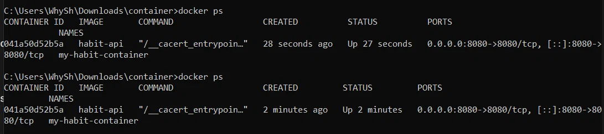
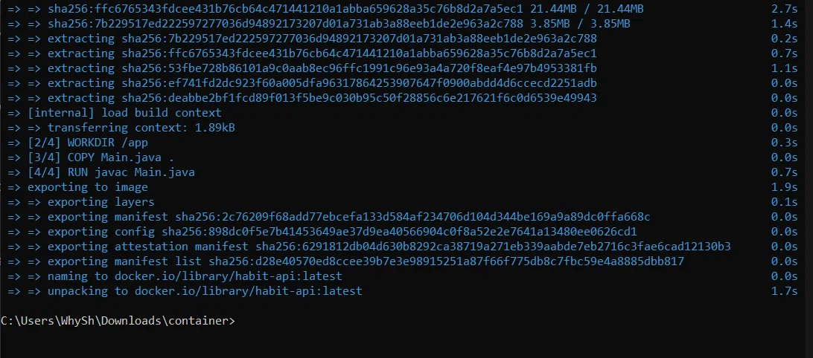
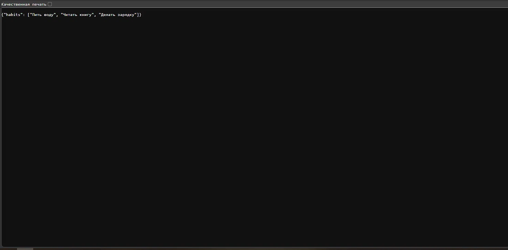

# Habit Tracker

Проект: трекер привычек. Позволяет создавать привычки, отмечать выполнение по дням и смотреть статистику.

## Структура проекта
- `README.md` — описание проекта
- `project-notes.md` — заметки по проекту
- `api-plan.md` — план API
- `git-conflict.md` — описание конфликта

## Статус проекта
В разработке. Добавлен раздел использования. API уточнён.

## Использование
1. Создайте привычку.
2. Отмечайте выполнение каждый день.
3. Смотрите статистику прогресса.

## GitHub Network
Ссылка на граф веток: https://github.com/1disappoint/habit-tracker/network

---

## Запуск API в Docker

### 1. Сборка Docker-образа
```bash
docker build -t habit-api .
```
### 2. Запуск контейнера с пробросом порта
```
docker run -d -p 8080:8080 --name my-habit-container habit-api
```
### 3. Проверка работы API
```
[http://localhost:8080/habits](http://localhost:8080/habits)
```
### 4. Проверка контейнера и логов
```
docker ps
docker logs my-habit-container
```
### Скриншоты работы



